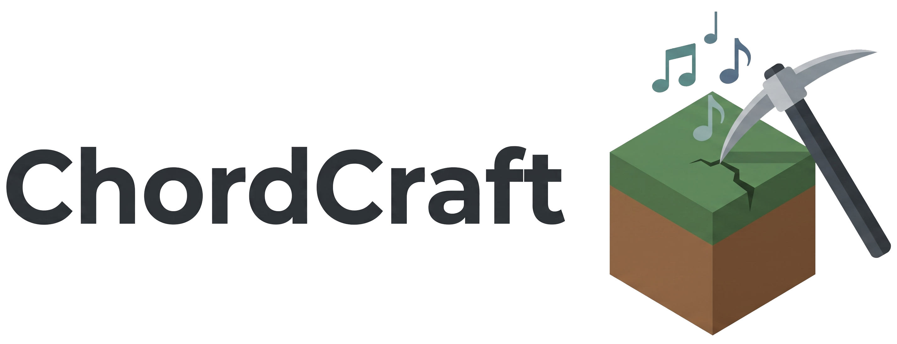

<div align="center">
  
</div>
<p align="center">
| <a href="docs/uso.md"><b>Guía de Uso</b></a> | <a href="https://github.com/aab626/plugin-juce/releases/latest"><b>Descarga</b></a> | <a href="docs/desarrollo.md"><b>Guía de Desarrollo</b></a> |
</p>

Plugin VST3 para generar acordes a partir de una nota de entrada. Desarrollado como plugin JUCE como proyecto del curso Seminario de Diseño e Innovación Tecnológica EL4030 de la FCFM, Universidad de Chile.

## Estructura del repositorio

```text
├── chordcraft/
│   ├── ChordCraft.jucer           # Proyecto Projucer
│   ├── Source/
│   │   ├── ChordEngine.cpp        # Cálculo de las notas del acorde
│   │   ├── ChordEngine.h
│   │   ├── PluginEditor.cpp       # Interfaz y controles
│   │   ├── PluginEditor.h
│   │   ├── PluginProcessor.cpp    # Procesamiento MIDI y estado del plugin
│   │   └── PluginProcessor.h
│   └── Tests/
│       └── ChordEngineTests.cpp   # Pruebas del motor de acordes
├── docs/                          # Documentación
└── CMakeLists.txt                 # Configuración de CMake
```
