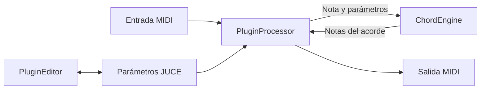

# Guía de desarrollo de ChordCraft

## Requisitos de desarrollo

- Compilador compatible con `C++17`
- JUCE 9.0.6, descargable [desde su repositorio](https://github.com/juce-framework/JUCE/releases/tag/9.0.6)
- DAW que admita MIDI output de efectos VST3

### Linux (Debian/Ubuntu)

Instalar el compilador y las bibliotecas de desarrollo con:

```bash
sudo apt update
sudo apt install build-essential pkg-config libasound2-dev \
  libfontconfig1-dev libfreetype-dev libx11-dev libxcomposite-dev \
  libxcursor-dev libxext-dev libxi-dev libxinerama-dev libxrandr-dev libxrender-dev
```

### macOS

- Command Line Tools de Apple.
- CMake 3.22 o superior

Ambos se instalan con:

```bash
xcode-select --install
brew install cmake
```

### Windows

- Visual Studio 2022 con el workload _Desarrollo para el escritorio con C++_. Se puede obtener desde acá: [Instalador de Visual Studio 2022 Community](https://aka.ms/vs/17/release/vs_community.exe).

Esto instala las dependencias y la terminal `x64 Native Tools Command Prompt for VS 2022` que se usa para compilar y testear el proyecto.

## Cómo funciona ChordCraft

ChordCraft recibe mensajes MIDI y devuelve las notas de un acorde. En un DAW, la salida del efecto se enruta a un instrumento para producir audio.



Cuando `PluginProcessor` recibe una nota que corresponde a una tecla blanca, consulta los parámetros y llama a `ChordEngine`. El motor asigna la tecla a uno de los siete grados de la escala elegida y calcula las notas del acorde. La amplitud ajusta su distribución entre octavas y la complejidad selecciona los intervalos del acorde para ese grado.

Con base Do, modo Mayor, amplitud Cerrado y complejidad 1, la nota MIDI 60 produce las notas 60, 64 y 67. El procesador envía esas notas por la salida MIDI con el canal y la velocidad de la entrada. Al soltar la tecla que las disparó, las apaga. Si llega otra tecla blanca antes, apaga el acorde anterior y activa el nuevo.

`PluginEditor` muestra los controles de base, modo, amplitud y complejidad. Los controles están conectados al `AudioProcessorValueTreeState` de JUCE, que almacena los valores que lee el procesador. El procesador guarda y recupera esos valores cuando el DAW guarda o restaura el estado del plugin.

## Dónde hacer cambios

- Las tablas `majorVoicings` y `minorVoicings` en [ChordEngine.cpp](../chordcraft/Source/ChordEngine.cpp) definen los intervalos de cada acorde según el grado y la complejidad. `makeChord` usa esas tablas y aplica la distribución por octavas.
- `processBlock` en [PluginProcessor.cpp](../chordcraft/Source/PluginProcessor.cpp) recibe y emite los mensajes MIDI. Las funciones `triggerChord` y `stopActiveChord` encienden y apagan el acorde activo. En el mismo archivo, `createParameterLayout` define las opciones y los valores iniciales de los parámetros.
- El constructor del editor de [PluginEditor.cpp](../chordcraft/Source/PluginEditor.cpp) configura los controles y los conecta con sus parámetros.
- Un cambio en las reglas del motor se puede comprobar con un caso de prueba en [ChordEngineTests.cpp](../chordcraft/Tests/ChordEngineTests.cpp) que compare las notas de `makeChord` con las esperadas.

## Compilación y comprobación

El proyecto genera el VST3 y la aplicación Standalone. Los comandos de compilación parten de la raíz del clon y usan la configuración `Release`. Para depurar se puede usar `Debug`.

```sh
git clone https://github.com/aab626/plugin-juce.git
cd plugin-juce
```

### Exportar el proyecto con Projucer en Linux y Windows

1. Abrir Projucer desde la copia local de JUCE. En `File > Global Paths`, seleccionar la carpeta `JUCE` y `modules/` desde el dicectorio **JUCE** descargado.
2. Abrir `chordcraft/ChordCraft.jucer` en Projucer y guardarlo con `File > Save Project`. Esto genera los proyectos de compilación en `chordcraft/Builds/`.
3. Compilar con el exportador de la plataforma:

#### Linux (Debian/Ubuntu)

```sh
make -C chordcraft/Builds/LinuxMakefile CONFIG=Release -j2
```

- En `chordcraft/Builds/LinuxMakefile/build/` quedan el paquete `ChordCraft.vst3/` y el ejecutable `ChordCraft`. El Makefile también copia el VST3 a `~/.vst3/`.
- En Ubuntu, si el Makefile usa `pkg-config` de Homebrew y no encuentra ALSA, se puede forzar la ruta a las librerias con `PKG_CONFIG=/usr/bin/pkg-config` (o el _path_ apropiado a `pkg-config` local).

#### macOS

```sh
cmake -S . -B build -G "Unix Makefiles" \
  -DCMAKE_BUILD_TYPE=Release \
  -DCMAKE_OSX_ARCHITECTURES="arm64;x86_64" \
  -DJUCE_PATH="/ruta/a/JUCE"
make -C build -j2
```

- Los resultados quedan en `build/ChordCraft_artefacts/Release/VST3/ChordCraft.vst3` y `build/ChordCraft_artefacts/Release/Standalone/ChordCraft.app`.

#### Windows con Visual Studio

Ejecutar en la terminal `x64 Native Tools Command Prompt for VS 2022`:

```bat
msbuild "chordcraft\Builds\VisualStudio2022\ChordCraft.sln" /m /p:Configuration=Release /p:Platform=x64
```

- Los resultados quedan en `chordcraft/Builds/VisualStudio2022/x64/Release/`. El VST3 en `VST3/ChordCraft.vst3/` y el ejecutable en `Standalone Plugin/ChordCraft.exe`.

### Tests del motor

#### Linux (Debian/Ubuntu)

Se compila como un ejecutable aparte en la carpeta `chordcraft/Builds/` que genera Projucer.

```sh
c++ -std=c++17 -O2 chordcraft/Source/ChordEngine.cpp \
  chordcraft/Tests/ChordEngineTests.cpp -o chordcraft/Builds/ChordEngineTests
./chordcraft/Builds/ChordEngineTests
```

#### macOS

CTest ejecuta la prueba registrada en `build/`.

```sh
ctest --test-dir build --output-on-failure
```

#### Windows

Ejecutar en la terminal `x64 Native Tools Command Prompt for VS 2022`:

```bat
cl /nologo /std:c++17 /EHsc /O2 /DNDEBUG /Fochordcraft\Builds\VisualStudio2022\ /Fechordcraft\Builds\VisualStudio2022\ChordEngineTests.exe chordcraft\Source\ChordEngine.cpp chordcraft\Tests\ChordEngineTests.cpp
chordcraft\Builds\VisualStudio2022\ChordEngineTests.exe
```
