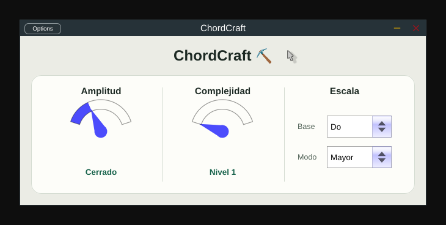

# Guía de uso de ChordCraft

## Descargar

Consulta los requisitos en las notas de la release y descarga la última versión desde [Releases](https://github.com/aab626/plugin-juce/releases/latest),
debes descargar el `zip` apropiado según tu plataforma:

- **Windows x64**: `windows-x86_64`
- **macOS x64/ARM**: `macos-universal`
- **Linux x86_64**: `linux-x86_64`

## Instalar el plugin

1. Extrae el ZIP.
2. Con el DAW cerrado, copia la carpeta completa `ChordCraft.vst3` a la carpeta de escaneo de plugins para tu DAW, tipicamente estas son:

   - **Windows x64**: `C:\Program Files\Common Files\VST3\`
   - **macOS x64/ARM**: `~/Library/Audio/Plug-Ins/VST3/`
   - **Linux x86_64**:  `~/.vst3/`

3. Abre el DAW y de ser necesario, vuelve a escanear los plugins VST3.

### Usar el efecto

1. Crea una pista y agrega el efecto `ChordCraft` antes de algún instrumento.
2. Asegúrate que los _MIDI Inputs_ y _MIDI Outputs_ estén activados (puede variar según el DAW).
3. Reproduce un _input_ MIDI (por ejemplo mediante el teclado del DAW), deberías escuchar un acorde completo.

#### Ajustar el acorde

- Usa `Base` para elegir la nota principal de la escala.
- Con `Modo` eliges entre `Mayor` y `Menor` (menor natural).
- `Amplitud` distribuye las notas del acorde entre octavas.
  - `Cluster` reúne las notas dentro de una octava a partir de la fundamental.
  - `Cerrado` conserva la distribución original de las notas del acorde.
  - `Abierto` sube una octava algunas notas del acorde.
  - `Amplio` aplica la misma distribución que `Abierto` y baja la fundamental una octava si queda dentro del rango MIDI.
- `Complejidad` permite variar las notas que forman el acorde en cinco niveles, el resultado depende del grado que se toca y del modo de la escala.
